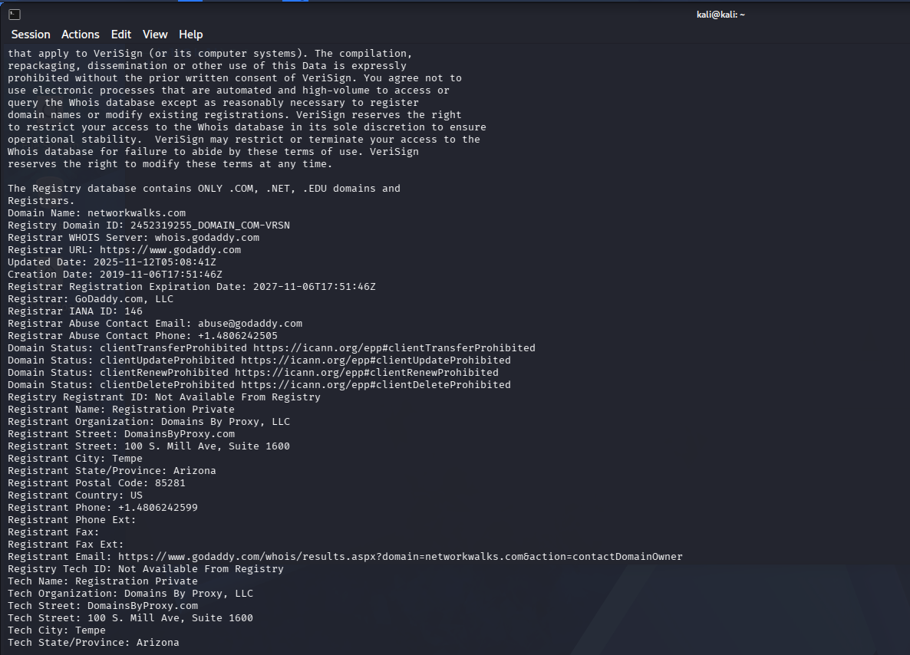
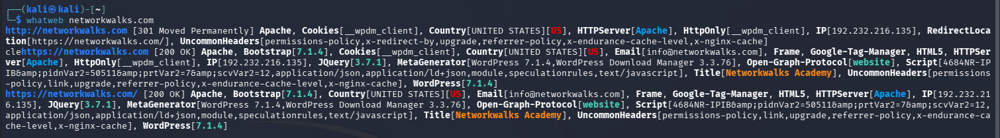
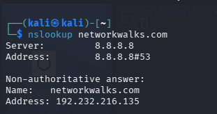
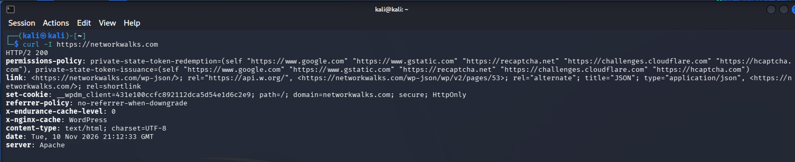
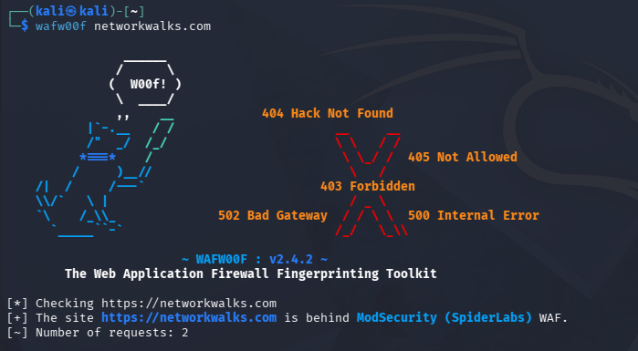
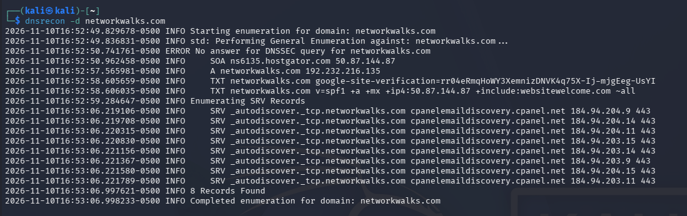
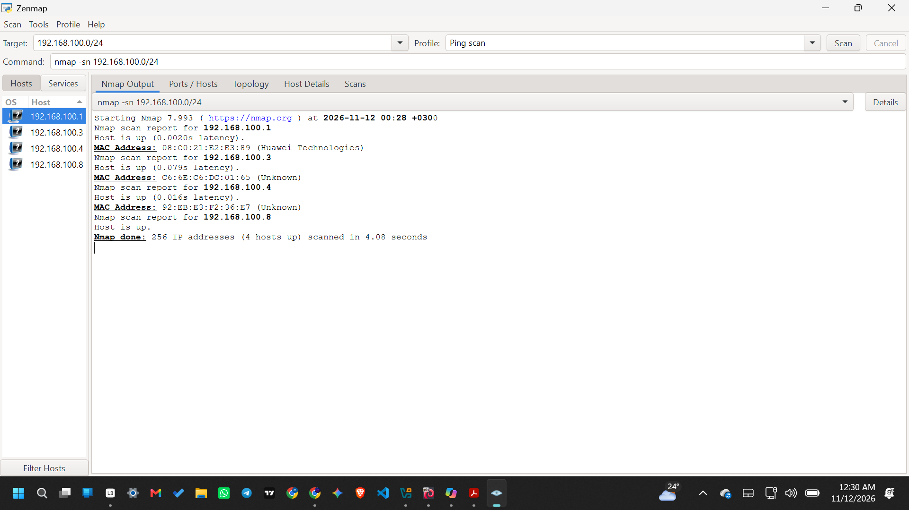

# 🔐 Week 2 Cybersecurity Assessment Report

## Footprinting and Network Scanning using Kali Linux & Zenmap

**Author:** Arnold Mumo Kilonzo  
**Internship:** NetworkWalks Cybersecurity Internship  
**Week:** 2

---

# 📌 Introduction

This project focused on the first two phases of a cybersecurity assessment:

1. Reconnaissance (Footprinting)
2. Network Scanning

The objective was to gather publicly available intelligence about a target domain using Kali Linux footprinting tools and perform network discovery using Zenmap.

---

# 🎯 Objectives

- Perform footprinting and reconnaissance activities.
- Gather publicly available information about a target domain.
- Identify website technologies and infrastructure.
- Perform DNS analysis and enumeration.
- Detect web security controls.
- Discover live hosts on a local network.
- Identify IP and MAC addresses of network devices.
- Create a network topology map.
- Document findings professionally.

---

# 🛡️ Phase 1: Footprinting with Kali Linux

Target Domain:

```text
networkwalks.com
```

---

# 1. WHOIS Analysis

### Command

```bash
whois networkwalks.com
```

### Screenshot



### Findings

- Domain Name: networkwalks.com
- Registrar: GoDaddy LLC
- Domain Privacy Protection Enabled
- DNS Infrastructure Identified
- Registration Information Retrieved

### Purpose

WHOIS was used to gather domain registration information and understand the target's DNS infrastructure.

---

# 2. Website Fingerprinting with WhatWeb

### Command

```bash
whatweb networkwalks.com
```

### Screenshot



### Findings

- Apache Web Server Detected
- WordPress CMS Detected
- WordPress Download Manager Plugin Identified
- Public Email Address Found
- HTTPS Enabled
- Public IP Address Identified

### Purpose

Used to fingerprint technologies operating behind the target website.

---

# 3. DNS Resolution with NSLookup

### Command

```bash
nslookup networkwalks.com
```

### Screenshot



### Findings

- DNS Server Used: 8.8.8.8
- Domain Successfully Resolved
- Public IP Address Discovered

```text
192.232.216.135
```

### Purpose

NSLookup was used to translate the domain name into its corresponding IP address.

---

# 4. HTTP Header Enumeration

### Command

```bash
curl -I https://networkwalks.com
```

### Screenshot



### Findings

- HTTP/2 Supported
- Apache Server Detected
- WordPress Infrastructure Confirmed
- Secure Cookies Enabled
- HttpOnly Cookies Enabled
- Security Headers Present

### Purpose

HTTP headers were analyzed to identify server information and security configurations.

---

# 5. Web Application Firewall Detection

### Command

```bash
wafw00f networkwalks.com
```

### Screenshot



### Findings

```text
ModSecurity (SpiderLabs) WAF Detected
```

### Purpose

Used to identify security protections implemented on the target website.

---

# 6. DNS Enumeration

### Command

```bash
dnsrecon -d networkwalks.com
```

### Screenshot



### Findings

- DNS Records Enumerated
- TXT Records Identified
- SPF Records Discovered
- DNS Infrastructure Confirmed
- Public IP Verified
- Google Verification Record Identified

### Purpose

Performed advanced DNS reconnaissance and infrastructure discovery.

---

# 🌐 Phase 2: Network Scanning with Zenmap

The second phase focused on network discovery and host identification within a local subnet.

---

# Network Information

### Local IP Address

```text
192.168.100.8
```

### Network Subnet

```text
192.168.100.0/24
```

### Default Gateway

```text
192.168.100.1
```

---

# Ping Scan

### Scan Profile

```text
Ping Scan
```

### Target

```text
192.168.100.0/24
```

### Screenshot



### Findings

#### Live Hosts Discovered

| IP Address | Device |
|------------|---------|
| 192.168.100.1 | Router |
| 192.168.100.3 | Mobile Device |
| 192.168.100.4 | Mobile Device |
| 192.168.100.8 | Host Laptop |

### Total Active Hosts

```text
4 Hosts
```

---

# MAC Address Discovery

| IP Address | MAC Address |
|------------|-------------|
| 192.168.100.1 | 08:C0:21:E2:E3:89 |
| 192.168.100.3 | C6:6E:C6:DC:01:65 |
| 192.168.100.4 | 92:EB:E3:F2:36:E7 |
| 192.168.100.8 | EC-21-50-AF-56-5E |

### Purpose

To uniquely identify devices on the local network using hardware addresses.

---

# Network Topology Mapping

### Screenshotdings

The topology diagram successfully mapped:

- Router
- Laptop
- Two Mobile Devices

within the local subnet.

### Purpose

Visualize network relationships and identify active network assets.

---

# 🔍 Key Findings

## Footprinting Findings

- Domain ownership information identified.
- Website technologies discovered.
- Apache Web Server identified.
- WordPress CMS detected.
- Public IP Address obtained.
- DNS records enumerated.
- Web Application Firewall identified.

## Network Scanning Findings

- Four live hosts discovered.
- Local subnet mapped successfully.
- Device IP addresses identified.
- MAC addresses identified.
- Network topology visualized.

---

# 📚 Skills Acquired

Through this project I gained practical experience in:

- Footprinting and Reconnaissance
- Open Source Intelligence (OSINT)
- WHOIS Analysis
- Website Fingerprinting
- DNS Analysis
- DNS Enumeration
- HTTP Header Analysis
- Web Application Firewall Detection
- Kali Linux Reconnaissance Tools
- Zenmap Network Scanning
- Host Discovery
- Network Enumeration
- IP Address Identification
- MAC Address Identification
- Network Topology Mapping
- Cybersecurity Documentation
- Technical Reporting

---

# 🎓 Conclusion

This project successfully demonstrated two critical stages of a cybersecurity assessment: reconnaissance and network scanning.

Using Kali Linux footprinting tools, valuable information about a target domain's infrastructure, technologies, DNS services, and security controls was collected. Zenmap was then used to discover active devices, identify hosts, and visualize a local network topology.

The exercises strengthened practical cybersecurity skills in information gathering, attack surface discovery, network enumeration, and security documentation.

---

# 👨‍💻 Author

**Arnold Mumo Kilonzo**

Bachelor of Science in Information Technology  
University of Embu

### Areas of Interest

- Cybersecurity
- Network Administration
- IT Support
- Ethical Hacking
- Linux Administration
- Artificial Intelligence
